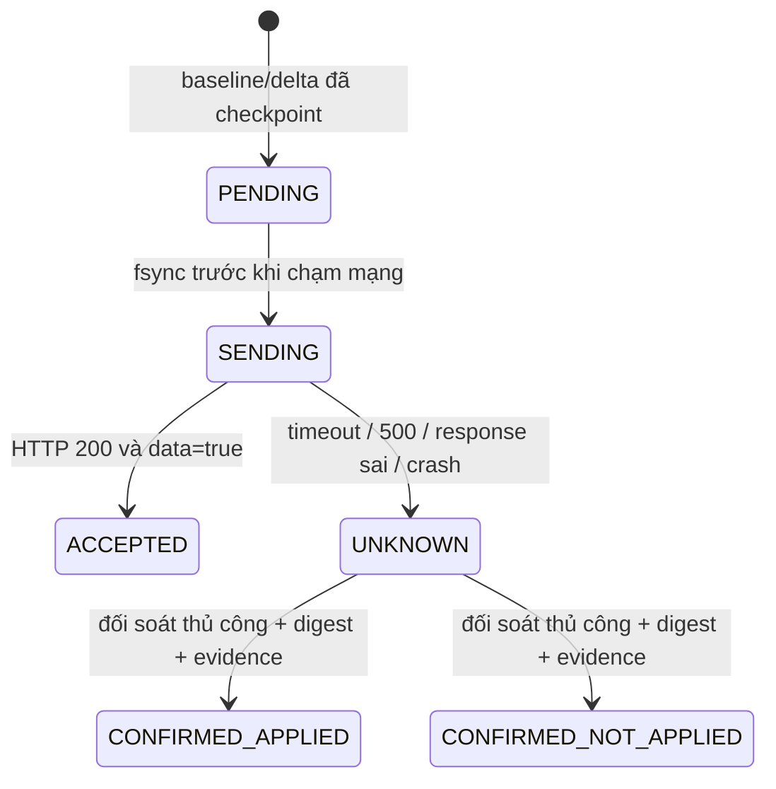

# Chính sách traffic không thay đổi panel

Source V2B-ZIC được giữ chỉ đọc. Không thêm API, field, idempotency header, migration, bảng DB, Redis key hoặc queue/job nào. Daemon không có sender đang hoạt động. Sender thư viện chỉ được bật trong test có HTTPS endpoint IP loopback; mọi đích ngoài loopback bị từ chối trước khi reserve batch. Chỉ dữ liệu giả được dùng.

## Trạng thái và ranh giới bền vững

Không có cạnh từ UNKNOWN hoặc CONFIRMED_NOT_APPLIED trở lại PENDING. Không tự retry. Trường hợp chết sau fsync SENDING nhưng trước khi gửi byte nào cũng thành UNKNOWN; đây là chủ ý tránh đếm lặp, chấp nhận cần đối soát cả một số batch thực tế chưa gửi. UNKNOWN/SENDING hoặc incident chưa xác nhận chặn các batch tiếp theo trong sender test.

ACCEPTED chỉ mô tả phản hồi HTTP mà controller panel công bố; không gọi nó ACK/delivered/billed. Source dispatch ba job; chưa kiểm chứng runtime queue driver. Mất response và job retry/partial increment không thể được agent sửa đơn phương.

Ledger v2 chứa counter baseline, pending, queue, sequence và incident trong cùng file envelope checksum. Quan sát counter cập nhật baseline và pending cùng checkpoint; chuyển pending sang queue cũng cùng checkpoint, không có file thứ hai phải cập nhật theo thứ tự. Ghi temp 0600, fsync file, rename, fsync directory; RAM chỉ advance sau thành công. Lỗi I/O phải dừng/reload, không viết lại từ RAM cũ vì rename có thể đã thành công dù fsync báo lỗi.

Trong manage-test, lỗi state/control nghiêm trọng sẽ thử đóng inbound thuộc quyền sở hữu bằng inspect/remove/inspect mà không retry checkpoint lỗi. Đây là containment bảo thủ, không transaction với ledger và không bảo đảm cắt mọi session cũ. Nếu API core không đáp ứng thì không xác minh được việc đóng; lỗi được trả ra để operator can thiệp trong lab.

Batch có ID từ node identity + sequence, epoch, digest payload, attempts và trạng thái. Batch chưa thử có thể gộp delta mới để offline không tạo file/batch theo mỗi phút; digest có thể thay đổi trước SENDING. Từ SENDING, payload và digest đóng băng. Không sửa payload UNKNOWN để nhét thêm traffic; byte mới đi vào batch PENDING khác.

Chỉ có một worker; cùng OS lock được dùng cho daemon và lệnh thay đổi đối soát. Status đọc checkpoint atomic không sửa SENDING và không cần dừng daemon. Khi khởi tạo dưới lock, SENDING được ghi thành UNKNOWN trước mọi khả năng gửi. Batch đã ACCEPTED hoặc đã quyết định thủ công cũng không được gửi lại.

## API hiện tại

POST duy nhất được triển khai trong thư viện lab là `/api/v1/server/UniProxy/push?token=...&node_id=...&node_type=vless`, JSON object `{"42":[upload_bytes,download_bytes]}`. Không gửi envelope batch của agent lên panel, không nhân rate. Token không nằm trong argv/env/log. HTTPS xác minh chứng chỉ; redirect bị từ chối cả khi caller đặt chính sách redirect lỏng. Body không có rewind/GetBody, không gắn header khiến HTTP transport coi POST là idempotent.

Chỉ đúng HTTP 200 + object JSON `{"data":true}` mới thành ACCEPTED. HTTP 500, 401/403/429, transport error, timeout, malformed/duplicate/oversized JSON, data=false hoặc field lạ đều thành UNKNOWN sau lần thử duy nhất. Một số lỗi auth chắc chắn chưa xử lý traffic theo source vẫn bị phân loại bảo thủ; không đánh đổi an toàn bằng suy luận lỗi body hoặc retry tự động.

`traffic_send_enabled=true`, production manage mode và CLI send/retry đều bị từ chối. Không có đường gọi sender từ daemon; ngay cả manage-test cũng chỉ thu/gộp queue. Các request POST trong kiểm thử chỉ chạm mock TLS loopback với counter in-memory giả, không panel PHP/Redis/DB thật.

## Counter, restart và reboot

- QueryStats luôn reset=false; email Stats chứa Node ID, user ID và thế hệ UUID. Đọc cùng snapshot nhiều lần hoặc khởi động lại agent với cùng epoch chỉ cộng phần tăng mới.
- Mẫu đầu tiên của một ledger mới là baseline, không tính tiền byte trước đó để tránh nhận nhầm lịch sử đã tính.
- Đổi boot ID/PID/starttime chứng minh tiến trình core mới: pending cũ được queue trong cùng transaction, counter mới lấy từ zero. Incident mở ghi rõ tail của core cũ không biết được; gửi bị chặn, nhưng thu counter mới tiếp tục.
- Epoch thay đổi giữa hai lần đọc bao RPC: không dùng mẫu trộn; thử lại ở lịch tiếp theo, không tự bịa delta.
- Counter giảm/biến mất trong cùng epoch: giữ checkpoint cũ, ghi incident nếu có thể, dừng. Không clamp delta âm thành 0 rồi tuyên bố dữ liệu đầy đủ. Acknowledge-gap không tự đổi baseline; reset cần đối soát riêng.
- Cần PID file đúng core của API, parent/file không cho người không tin cậy ghi. API loopback không tự chứng minh endpoint thuộc PID đó; operator phải xác minh.

## Rủi ro dữ liệu còn tồn tại

1. **Không biết kết quả billing thật:** data=true có thể chưa tương ứng job commit; job retry/partial update của panel vẫn có thể cộng lặp dù agent không retry.
2. **UNKNOWN có thể là đã nhận hoặc chưa nhận:** để nguyên thì có thể trì hoãn/thiếu billing; quyết định thủ công sai hoặc tự POST export bên ngoài có thể gây thiếu/trùng. Lệnh not-applied không tự gửi bù.
3. **Core crash/reset:** byte sau mẫu bền vững cuối có thể mất; baseline đầu không tính lịch sử trước agent. Reset ngoài agent có thể không phát hiện nếu counter mới kịp vượt mốc cũ.
4. **Đĩa/filesystem/state:** hết đĩa, I/O error, corrupt/mất ledger, cache volatile, backup cũ hoặc clone state sang hai agent có thể làm mất evidence hoặc tái gửi dữ liệu cũ. Checksum phát hiện hỏng byte, không phát hiện rollback hợp lệ. Không tự restore backup, không chạy hai agent/VPS cho cùng node từ cùng bản sao state.
5. **Giới hạn dung lượng:** checkpoint tối đa 8 MiB; 20.000 counter, 256 batch, 64 incident, 5.000 user/batch. Không tự xóa UNKNOWN/PENDING/ACCEPTED hoặc compact evidence; khi hết chỗ dừng và giữ lần ghi cuối, core có thể vẫn sinh tail chưa checkpoint. Cần đối soát/retention có phê duyệt trước vận hành dài hạn.
6. **Rate và thời gian:** panel áp rate lúc xử lý; backlog qua thay đổi rate hoặc ngày thống kê có thể bị hạch toán theo thời điểm gửi/job chạy. API không cung cấp dữ liệu để tái dựng rate lịch sử ở agent.
7. **Quyền và phiên đang mở:** danh sách panel chỉ chứa user còn quyền tại lần kéo; không có expiry/quota còn lại. Offline lease có độ trễ timer/request; API Xray lỗi có thể cản thu hồi. RemoveUser/inbound không chứng minh mọi session cũ chấm dứt ngay, byte vẫn có thể phát sinh.
8. **Cặp config/users không là transaction server:** hai GET/ETag độc lập, có thể đổi giữa request. Snapshot local atomic không biến chúng thành cùng revision bên panel.

Không sửa panel để che các giới hạn này và không tuyên bố không mất data tuyệt đối. Trạng thái mặc định tránh hoàn toàn rủi ro POST vào panel thật vì gửi mạng bị tắt.

Vì gửi mạng bị tắt, byte mới trong ledger/queue chưa cập nhật billing hoặc quota ở panel. Không dùng manage-test như một node dịch vụ có thu phí/giới hạn dung lượng thật.
